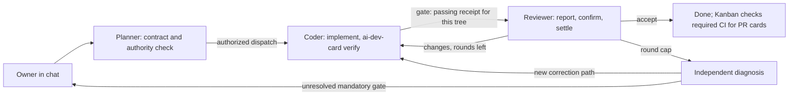

# ai-dev

Verification and review gates for coding cards on a [Hermes](https://github.com/NousResearch/hermes-agent) Kanban board.

Hermes Kanban already runs the work: its dispatcher claims a card, starts the assigned profile as a process, notices a crashed or silent worker, retries, parks a blocked card and notifies the chat. ai-dev adds the two things Kanban leaves to the model:

- **A card reaches review only with a passing verification of its exact tree.** Approved checks run on the working copy as it is, the result is bound to the tree ID, and environment failures are told apart from defects.
- **Review converges.** Reviewers report findings, code decides the outcome. A blocker must name the criterion it violates and be reproduced by a failing test. Settled findings stay settled, later rounds review only the delta, and a capped round triggers an independent diagnosis before another correction.

Both are enforced by a Hermes plugin that refuses `kanban_request_review`, `kanban_complete` and `kanban_request_changes` until the evidence exists.

## How a card moves



## Contents

| Path | What it is |
| --- | --- |
| `ai_dev/` | The package: card store, policy, verification runner, review protocol, gate. Python standard library only. |
| `bin/ai-dev-card` | What workers run: `status`, `contract`, `verify`, `review`, `confirm`, `finding`, `doctor`. |
| `hermes/plugin/ai-dev-gate/` | The Hermes plugin. One `pre_tool_call` hook. |
| `hermes/skills/` | `ai-dev-planner`, `ai-dev-card`, `project-onboarding`. |
| `hermes/install.py` | Installs programs, plugin and skills into Hermes profiles. |
| `stands/` | Drivers for project verification stands (SSH guest, Proxmox power). |
| `bin/ai-dev`, `ai-dev-discover`, `ai-dev-analyze`, `ai-dev-style-default` | Project onboarding: register repositories, analyze them, generate working docs. |
| `bin/ai-dev-incident`, `bin/ai_dev_board.py` | GitHub issue follow-ups and Projects board sync. Not wired into the card flow yet. |

## Read next

- [Install](INSTALL.md)
- [Architecture](docs/architecture.md): what Hermes does, what ai-dev does, where state lives, what is not enforced
- [Review protocol](docs/review-protocol.md)
- [Project workflow requirements](docs/project-workflow.md)
- [Operations](docs/operations.md): board and profile setup, the policy file, running a card, owner decisions
- [Research](docs/research/): the 2026-11-20 comparison of autonomous coding systems

## Status

Version 2 replaces the 1.x orchestrator (supervisor, coordinator, run phases, task journal). The package and its tests run without Hermes. The plugin follows the hook contract documented in Hermes v0.23.4 and present in 0.21.5; it has not yet been exercised inside a live Hermes worker. The first live run is the next step, see [operations](docs/operations.md#first-live-run).

```sh
python3 -m unittest discover -s tests
```
