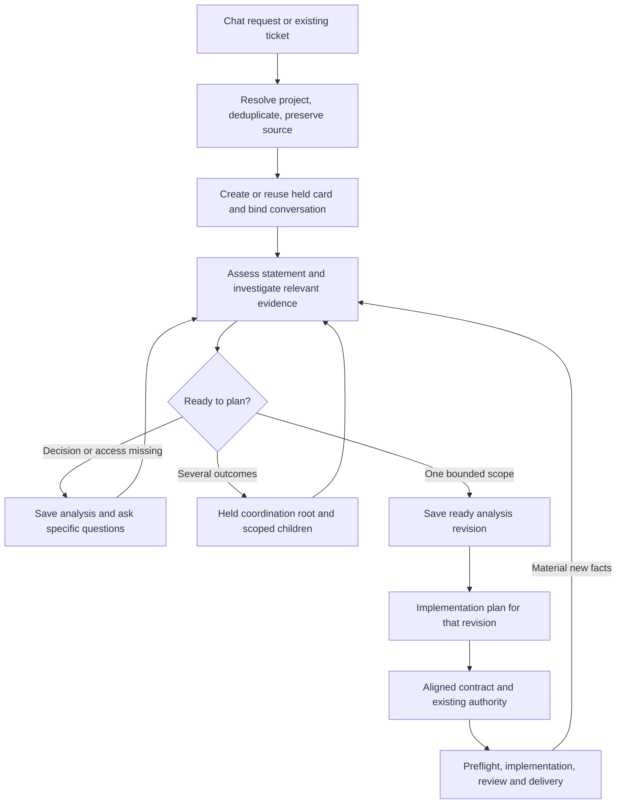

# Task analysis before implementation planning

Requests from chat and existing tracker tickets follow the same path:



The [planner procedure](../hermes/skills/ai-dev-planner/references/task-analysis.md) is the operational source of truth, with a [structured template](../hermes/skills/ai-dev-planner/references/analysis-template.json). It covers source selection, query limits, facts versus hypotheses, scope, decomposition, readiness, owner decisions and chat intake. The planner performs research; this change does not install Snowflake, Grafana or database connectors. Source availability and permissions belong to each project.

## Standards and practices considered

Research date: 2026-11-26. These are different kinds of references, not one universal ticket standard or a claim of certification.

- [ISO/IEC/IEEE 29148:2018](https://www.iso.org/standard/72089.html) addresses requirements engineering processes and information artifacts across the lifecycle. Its public abstract supports separating requirements work from implementation planning. The full paid standard was not reviewed; Ratchet does not claim conformance. The ISO page lists the published 2018 edition and a successor draft.
- [Scrum Guide 2020](https://scrumguides.org/scrum-guide.html) describes ongoing backlog refinement into smaller, clearer items. Ratchet adopts iterative refinement and decomposition without imposing Scrum roles or sprint machinery on Hermes.
- [INVEST](https://agilealliance.org/glossary/invest/) provides practical user-story quality criteria. Ratchet applies coherent scope, value, feasible sizing and testability, with technical/research tasks allowed their own format.
- [Scrum.org on readiness](https://www.scrum.org/resources/blog/trying-keep-things-simple-ready) cautions against turning an optional Definition of Ready into rigid paperwork. Ratchet avoids arbitrary criterion counts or mandatory queries to every source. Its structural check is a local automation control, not a Scrum requirement.
- [NASA Systems Engineering Handbook, appendices C and D](https://www.nasa.gov/reference/system-engineering-handbook-appendix/) offers requirements quality and verification traceability checklists. Ratchet uses clear, consistent, feasible, verifiable outcomes linked to contract scenarios, scaled to the task rather than copying aerospace documentation.
- [Google SRE, Effective Troubleshooting](https://sre.google/sre-book/effective-troubleshooting/) describes searchable problem reports, including reports received by messaging, evidence-based investigation and incident triage. Ratchet captures chat requests as cards, distinguishes observations from hypotheses, and keeps authorized incident containment ahead of permanent-fix paperwork.

## Durable records and enforcement

`ai-dev-card analysis set --file FILE` stores a validated, redacted revision in `card.json.analyses`; `analysis show` displays the latest. The original source kind/reference/text is preserved across revisions. Later requests and decisions belong in evidence and revised scope, not a replacement source. Repeated identical saves do not create revisions.

Analysis records capture the problem, desired result, canonical repository, included/excluded scope, criteria, constraints, facts, hypotheses, evidence with checked/unavailable/not-needed status, blocking unknowns, risks, decomposition and research budget. Ready analysis requires criteria, evidence, risk assessment, no blocking unknowns and one implementation scope. Split roots cannot receive implementation plans. Intermediate blocked analysis is valid and keeps work resumable.

Only then can `ai-dev-card plan set --file FILE` record:

```json
{
  "analysis_revision": 1,
  "steps": ["Implement the scoped behavior in the identified component"],
  "validation": ["Exercise each analyzed criterion through its contract scenario"],
  "rollback": "Project-specific recovery or an explanation that deployment is outside scope",
  "authority": "Reference to the actual owner request or standing project workflow"
}
```

A new analysis revision makes the old plan stale. With policy `require_task_analysis: true`, candidate verification and coder/reviewer board gates require ready analysis, a plan for that revision, matching contract criteria/non-goals and the correct repository. Existing frozen-contract rules still govern weakening. Preflight remains usable for early baseline investigation and does not itself require a completed plan.

The default is false for compatibility in installations that have not adopted this workflow. Enable the policy for onboarded repositories or at installation defaults; never present an unconfigured installation as enforced. Existing cards do not receive fabricated retrospective analyses. Reopened/inherited work must be analyzed before its next implementation handoff.

These checks verify structure and consistency. They cannot prove that an observation is true, that a root cause is correct or that a quoted authorization is genuine. Readiness and source selection remain accountable planner judgments. The gate does not intercept arbitrary filesystem writes or native card creation; held-card routing and analysis-before-editing are role instructions. Hermes continues to own creation, scheduling, dependencies and notifications.

Research time is a recorded budget with role-level stop rules, not a new timer service. Small tasks can resolve in one short pass. Reaching the budget with material uncertainty produces a specific research or owner decision, not endless searching. Project controls must enforce actual query cost and read-only access.

Analysis/plan observations enter the existing ten-day analytics projection. The original request is excluded from that projection; authoritative card records remain under the normal evidence lifecycle. All external descriptions and retrieved source content are untrusted evidence, never instructions to execute.
